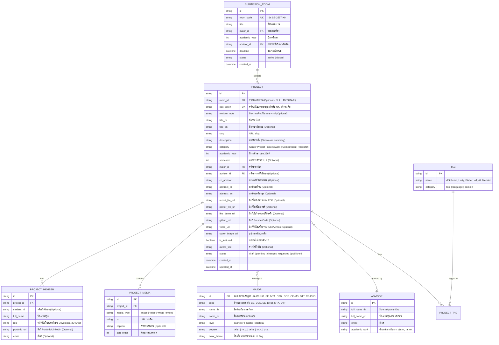

# 03. การออกแบบโครงสร้างข้อมูล (Data Schema & Taxonomy)

โครงสร้างฐานข้อมูลถูกออกแบบให้ **ยืดหยุ่นสูง (Flexible Schema)** เพื่อให้รองรับทั้งผลงานเก่าที่มีเพียงรูปภาพ และผลงานใหม่ที่มีข้อมูลเล่มรายงานครบถ้วน

---

## 1. ผังเอนทิตีหลัก (Core Entities)



---

## 2. จุดเด่นของการออกแบบ Schema นี้

1. **ปลอดภัยต่อข้อมูลเก่า (Old Projects Safe):**
   * ฟิลด์อย่าง `report_file_url`, `abstract_th`, `abstract_en`, `advisor_id`, `student_id` ล้วนเป็น `NULLABLE (Optional)`
   * งานเก่าแม้มีแค่ `title`, `cover_image_url`, `academic_year`, `major_id` ก็สามารถบันทึกและแสดงผลเป็นการ์ดผลงานที่สวยงามได้ทันที
2. **รองรับผลงานประเภทกลุ่ม:**
   * ตาราง `PROJECT_MEMBER` แยกออกมาอย่างชัดเจน สามารถระบุสมาชิกได้ตั้งแต่ 1 คน จนถึงทีมใหญ่ พร้อมระบุหน้าที่ (Role) ของแต่ละคนในโครงงานได้
4. **รองรับระบบห้องส่งงานและโทเคนแก้ไข (Room Code & Edit Token):**
   * ตาราง `SUBMISSION_ROOM` ช่วยให้อาจารย์สร้างรหัสห้องแจกเด็กได้หลายรอบ
   * ฟิลด์ `edit_token` ใน `PROJECT` ช่วยให้นักศึกษาสามารถกลับเข้ามาแก้ไขงานของกลุ่มตนเองได้โดยไม่ต้องสร้างบัญชีผู้ใช้ซับซ้อน และไม่เกิดงานซ้ำซ้อน
   * ฟิลด์ `room_id` เป็น `NULLABLE` เพื่อรองรับการที่อาจารย์หรือแอดมินเพิ่มงานเก่าเข้าสู่ระบบโดยตรง (Direct Add) โดยไม่ต้องผ่านห้องส่งงาน
     ```sql
     -- ตัวอย่างการดึงข้อมูลเพื่อสรุป AUN-QA แยกตามสาขา (CE, DCE, SE, DTBI, MTA, DTT)
     SELECT major_id, academic_year, COUNT(id) AS total_projects 
     FROM projects 
     WHERE category = 'Senior Project' AND status = 'published'
     GROUP BY major_id, academic_year;
     ```
