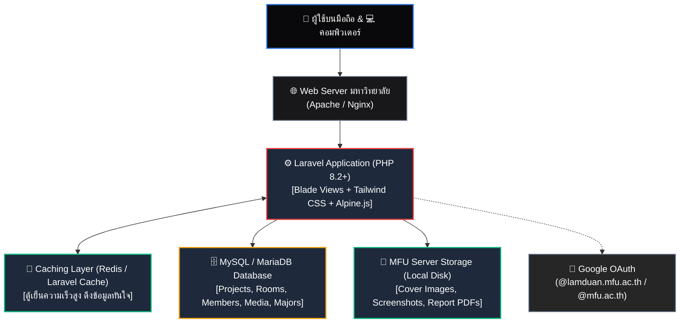

# 04. สถาปัตยกรรมและเทคโนโลยีที่ใช้ (Tech Stack & Architecture)

ปรับปรุงตามข้อกำหนดสภาพแวดล้อมจริงของ **Server มหาวิทยาลัยแม่ฟ้าหลวง (MFU Server Environment)** ซึ่งให้บริการบนโครงสร้าง **PHP & MySQL**:

---

## 1. การเลือกชุดเทคโนโลยี (Selected Tech Stack)

| ส่วนของระบบ | เทคโนโลยีที่เลือกใช้ | เหตุผลและความเข้ากันได้กับ Server มหาวิทยาลัย |
| :--- | :--- | :--- |
| **Backend & Core Framework** | **Laravel (PHP 8.2+)** | • รันบน Apache / Nginx + PHP ของ Server มอ ได้ 100%<br>• มีระบบความปลอดภัยสูง (CSRF, SQL Injection Protection, Auth)<br>• มี Eloquent ORM จัดการฐานข้อมูลและ Migration อย่างเป็นระบบ<br>• ทีมงานไอทีของมหาวิทยาลัยสามารถดูแลรักษาต่อได้ทันที |
| **Database (คลังสินค้าใหญ่)** | **MySQL 8.0+ / MariaDB** | • ระบบฐานข้อมูลมาตรฐานของ Server มหาวิทยาลัย<br>• รองรับโครงสร้าง Relational และ Foreign Keys ครบถ้วนตาม Schema ที่ออกแบบไว้ |
| **Caching Layer (ตู้เย็นความเร็วสูง)** | **Laravel Cache (รองรับ Redis หรือ File Cache)** | • เก็บข้อมูลที่คนเปิดดูบ่อยๆ ไว้ใน RAM/Cache (เหมือนตู้เย็นในบ้าน)<br>• ถ้า Server มี Redis ก็เปิดใช้ได้ทันที ถ้าไม่มีก็ใช้ Built-in File Cache ของ Laravel โดยไม่ต้องลงโปรแกรมเพิ่ม |
| **Frontend & UI Styling** | **Blade Templates + Tailwind CSS + Alpine.js** | • ดีไซน์สไตล์ **Shopify High-Contrast Editorial** (ดำสนิท `#000000`, ขาว `#FFFFFF`, ตัวหนังสือ Light Display, ขอบมนแคปซูล)<br>• รองรับ **Mobile-First Experience** 100% พร้อม Interactive Elements ที่ลื่นไหล<br>• คอมไพล์ผ่าน Vite รวดเร็วและโหลดหน้าเว็บได้ฉับไว |
| **Media & File Storage** | **Local Disk Storage บน Server มหาวิทยาลัย (Laravel Storage)** | • จัดเก็บรูปภาพหน้าปก แกลเลอรี และไฟล์เล่มรายงาน PDF ลงใน Storage ของ Server มอ โดยตรง<br>• ไม่ต้องเสียค่าบริการคลาวด์ภายนอก และแก้ปัญหาไฟล์สูญหายเมื่อ Drive เต็ม |
| **Authentication (การเข้าสู่ระบบ)** | **Google OAuth 2.0 (Socialite)** | • ล็อกอินผ่านอีเมลมหาวิทยาลัยแม่ฟ้าหลวง (`@lamduan.mfu.ac.th` และ `@mfu.ac.th`) |
| **Video Delivery** | **YouTube / Vimeo Embed** | • วิดีโอเดโมฝังลิงก์เพื่อประหยัดพื้นที่ดิสก์และแบนด์วิดท์ของ Server มหาวิทยาลัย |

---

## 2. การจัดการไฟล์และการควบคุมสิทธิ์ (Storage & Access Control)

1. **ภาพหน้าปกและภาพแกลเลอรี (Project Media):**
   * บันทึกเก็บใน `storage/app/public/projects/{id}/`
   * มีคำสั่ง Symlink เชื่อมต่อไปที่ `public/storage` เพื่อให้เบราว์เซอร์เข้าถึงรูปภาพได้อย่างรวดเร็ว
2. **ไฟล์เล่มรายงาน (Full Thesis PDF):**
   * บันทึกในไดเรกทอรีที่มีการป้องกันสิทธิ์ (Protected Storage)
   * ดาวน์โหลดผ่าน Controller ที่ตรวจสอบสิทธิ์ (ผู้ใช้ภายนอกดาวน์โหลดได้ หรือจำกัดเฉพาะล็อกอินด้วยอีเมล MFU)

---

## 3. ระบบแคชตู้เย็นเพื่อความเร็วสูงสุด (The "Refrigerator" Caching Strategy)

เพื่อไม่ให้หน้าเว็บต้องวิ่งไปค้นฐานข้อมูล MySQL (ห้างสรรพสินค้าใหญ่) ทุกครั้งที่มีคนเปิดดู:

```mermaid
flowchart LR
    A["🙋‍♂️ คนดูเว็บ (ลูกค้าในบ้าน)"] --> B["⚙️ Laravel (คนในบ้าน)"]
    
    B -->|1. หิว! เปิดหาในตู้เย็นก่อน| C["🧊 ตู้เย็น (Cache / Redis)<br/>• เก็บผลงานเด่นหน้าแรก<br/>• เก็บรายชื่อหลักสูตร CE, SE, MTA..."]
    
    C -- "มีของในตู้เย็น" -->|หยิบเสิร์ฟทันทีใน 0.05 วินาที| A
    
    C -. "ของหมดตู้เย็น / มีงานใหม่" .->|2. ขับรถไปเบิกของ| D["🏬 ห้างใหญ่ (MySQL Database)<br/>คลังข้อมูลทั้งหมด"]
    D -->|หยิบของมาตุนไว้ในตู้เย็น| C

    style A fill:#09090b,stroke:#3b82f6,stroke-width:2px,color:#ffffff
    style B fill:#1e293b,stroke:#ef4444,stroke-width:2px,color:#ffffff
    style C fill:#1e293b,stroke:#10b981,stroke-width:2px,color:#ffffff
    style D fill:#1e293b,stroke:#f59e0b,stroke-width:2px,color:#ffffff
```

### รายละเอียดการทำงานของระบบแคช (ตู้เย็น):
1. **ข้อมูลที่แช่ในตู้เย็น (Cached Items):**
   * **ผลงานหน้าแรก (Featured / Home Feed):** หน้าที่มีคนกดเข้าดูมากที่สุด จะถูกแคชไว้ เพื่อให้เปิดปุ๊บติดปั๊บในเสี้ยววินาที ไม่ต้อง Query ฐานข้อมูลซ้ำ
   * **รายชื่อหลักสูตรและแท็ก (Majors & Tags):** ข้อมูล CE, DCE, SE, DTBI, MTA, DTT ที่ไม่ค่อยเปลี่ยนแปลง
2. **ระบบเคลียร์ตู้เย็นอัตโนมัติ (Cache Invalidation / Auto-Refresh):**
   * เมื่ออาจารย์กด **Approve ผลงานใหม่** หรือมีการ **แก้ไขข้อมูลผลงาน** ระบบ Laravel จะสั่งล้างแคชเก่าในตู้เย็นทันที แล้วดึงข้อมูลสดใหม่มาแช่แทน ทำให้คนดูเห็นข้อมูลล่าสุดเสมอโดยที่เว็บไม่ค้าง

---

## 4. ผังสถาปัตยกรรมระบบรวม (System Architecture on MFU Server)


