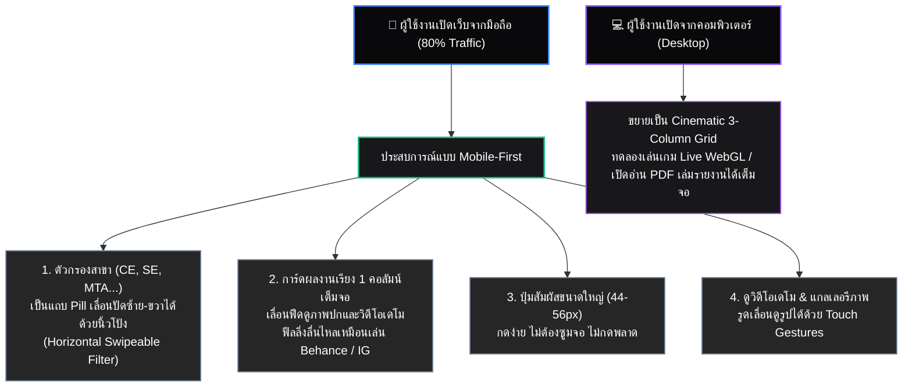

# 08. กลยุทธ์การออกแบบเพื่อการใช้งานบนมือถือ (Mobile-First Experience Strategy)

## 1. บริบทและพฤติกรรมผู้ใช้งาน (User Behavior Context)
ในประเทศไทย ผู้ใช้งานอินเทอร์เน็ตมากกว่า **80% เข้าชมเว็บไซต์ผ่านสมาร์ตโฟน (Mobile Devices)** โดยเฉพาะอย่างยิ่ง:
* **การแชร์ต่อบนโซเชียลมีเดีย:** ลิงก์ที่แชร์ผ่าน LINE, Facebook, Instagram, X (Twitter), หรือ LinkedIn จะถูกเปิดบนมือถือเกือบทั้งหมด
* **กลุ่มนักเรียนมัธยมและผู้ปกครอง:** ค้นหาหลักสูตรและดูผลงานผ่านมือถือในชีวิตประจำวัน
* **นายจ้าง / HR:** เปิดดูผลงานหรือคลิปเดโมของนักศึกษาอย่างรวดเร็วผ่านโทรศัพท์

ดังนั้นระบบ **MEMO.ADT ในส่วนการจัดแสดงผลงาน (Public Showcase) ต้องออกแบบภายใต้แนวคิด Mobile-First อย่างแท้จริง**

---

## 2. หลักการออกแบบสำหรับมือถือ (Mobile-First Principles)

### 2.1 Navigation & Header (แถบนำทาง)
* ความสูง 72px แถบกึ่งโปร่งใส (Sticky Navbar)
* โลโก้ ADT อยู่ซ้ายมือ ปุ่มค้นหาและเมนูแฮมเบอร์เกอร์อยู่ขวามือ แตะง่ายด้วยนิ้วโป้ง
* สอดคล้องกับสเปก `header-landing-mobile` สไตล์ Shopify

### 2.2 Horizontal Swipeable Filter Pills (แถบตัวกรองรูดได้)
* ปุ่มเลือกสาขา (`All`, `CE`, `DCE`, `SE`, `DTBI`, `MTA`, `DTT`) จะจัดเรียงเป็นแถวแนวนอน
* ผู้ใช้สามารถใช้นิ้วโป้งปัดซ้าย-ขวา (`overflow-x-auto`) เพื่อเปลี่ยนหมวดหมู่ได้ทันที ไม่เปลืองพื้นที่แนวตั้ง

### 2.3 Single-Column Immersive Feed (การ์ดแสดงผลงานเต็มจอ)
* บนมือถือ การ์ดผลงานจะแสดงผลเป็น 1 คอลัมน์เต็มความกว้างจอ (Full Width)
* ภาพหน้าปกขนาดใหญ่ อัตราส่วน 16:9 สวยงาม คมชัด ดึงดูดสายตาเหมือนดูฟีด Instagram หรือ Behance
* ตัวหนังสือขนาดพอเหมาะ อ่านง่ายโดยไม่ต้องซูมเข้า

### 2.4 Touch Target & Ergonomics (ขนาดปุ่มที่สัมผัสง่าย)
* ปุ่มกด Action ทุกชิ้นบนมือถือมีความสูงอย่างน้อย **44px ถึง 56px** ตามมาตรฐาน Mobile Accessibility
* รัศมีความโค้งมนแบบเต็มแคปซูล (`rounded-full` 9999px) ให้สัมผัสนุ่มนวล

---

## 3. การแสดงผลเมื่อสลับไปหน้าจอคอมพิวเตอร์ (Desktop Adaptability)
* เมื่อเปิดบนจอคอมพิวเตอร์ (หน้าจอกว้างกว่า 1024px):
  * ปรับจาก 1 คอลัมน์เป็น **3 คอลัมน์ (Cinematic 3-Column Grid)** อัตโนมัติ
  * รองรับการเปิดอ่านไฟล์เล่มรายงาน PDF แบบเต็มหน้าจอ (Embedded PDF Viewer)
  * รองรับการทดลองเล่นเกม WebGL (ถ้ามี) บนเบราว์เซอร์เดสก์ท็อปได้อย่างสมบูรณ์แบบ
